# prereview

prereview is a local review tool for what your agent produces. You comment
right on the artifact (a diff, a plan, a rendered doc, an image or a running dev
site) and the agent picks up each comment and makes the fix. The agent can also
propose edits that you accept or reject inline. It runs on your machine, works
with any agent, and you can review from your desk or your phone.

<p align="center">
  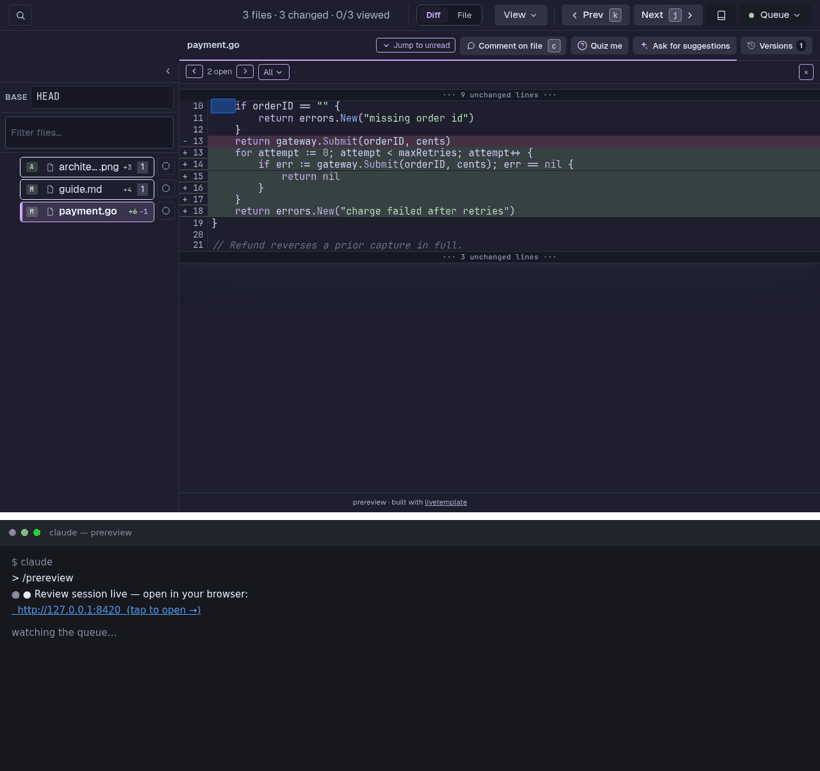
</p>

<p align="center"><sub><em>You comment on the diff, the agent edits the file, the fix appears in the diff, and you resolve it. Then the agent proposes an edit and you accept it.</em></sub></p>

Run `prereview` in a repo, or point it at any file or folder, and it opens a web UI.
Each comment is saved to `.prereview/comments.csv` and sent to your agent as soon
as you save it. Nothing is committed, and nothing leaves your machine.

## Use cases

- **Review a change before you commit.** Comment on the diff your agent wrote, and
  it fixes the lines you flagged. Review the working tree, a branch against `main`,
  or the last few commits.
- **Review a plan before the agent builds it.** Open the agent's plan file, comment
  on the steps you disagree with, and the agent revises the plan before it writes
  any code.
- **Edit docs and other prose.** Read a README or a design doc as GitHub renders it,
  comment on a block or a single phrase, and let the prose checks flag filler as
  you read.
- **Check a UI.** Drag a box on a screenshot, a diagram or your running dev site,
  and say what is wrong in that spot.
- **Understand a change you didn't write.** Quiz yourself on the diff, or ask the
  agent a question in a comment thread.
- **Teach the agent your preferences.** Your comments become lessons and then
  skills, so you don't have to make the same comment twice (see
  [The learning loop](#the-learning-loop)).

## Get started

```bash
curl -fsSL https://raw.githubusercontent.com/livetemplate/prereview/main/install.sh | sh
prereview --install-skill --client=claude   # once: the Claude Code integration
```

Then say `/prereview` in Claude Code, or "review my changes". The agent starts a
review and prints a link; you comment, and it applies the fixes. Run `prereview` on
its own to review without an agent. Homebrew, Scoop and `go install`, plus upgrading
and uninstalling, are in [docs/install.md](docs/install.md).

Or have your agent set it up. Tell it:

> Read https://raw.githubusercontent.com/livetemplate/prereview/main/docs/agent-setup.md and set up prereview.

## A tour

**Comment on rendered docs.** Markdown and HTML render the way GitHub shows them,
mermaid diagrams included. Tap a block and the comment anchors to its source lines.
Select a word or phrase to comment on just those characters.

<p align="center">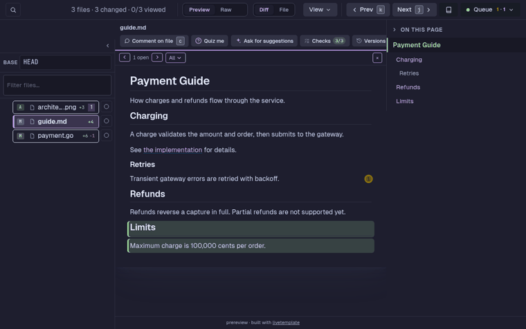</p>

**Comment on an image or a live site.** Drag a box on an image, or on a running dev
server that prereview proxies with `--external`.

<p align="center">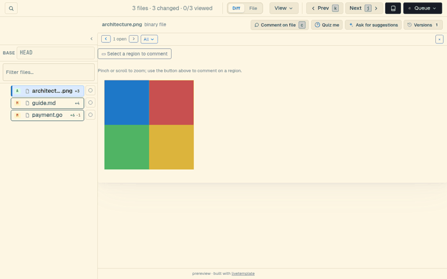</p>

<p align="center">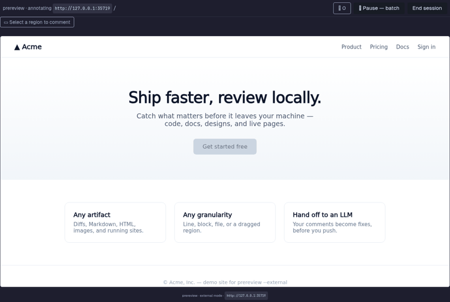</p>

**Talk it through.** Every comment is a thread. The agent replies to say what it did
or to ask a question, and your answer goes straight back to it. The Queue shows
whether an agent is connected and where each comment stands.

<p align="center">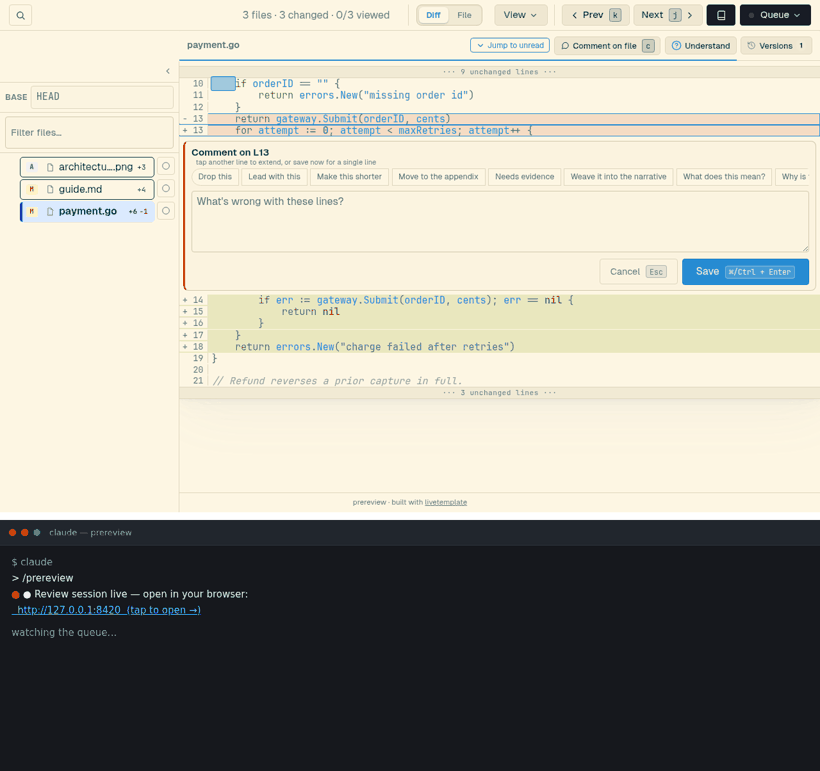</p>

**Take the agent's edits.** Ask for suggestions and each one appears as a before →
after box you accept or reject. prereview never edits your files: the agent applies
what you accept.

<p align="center">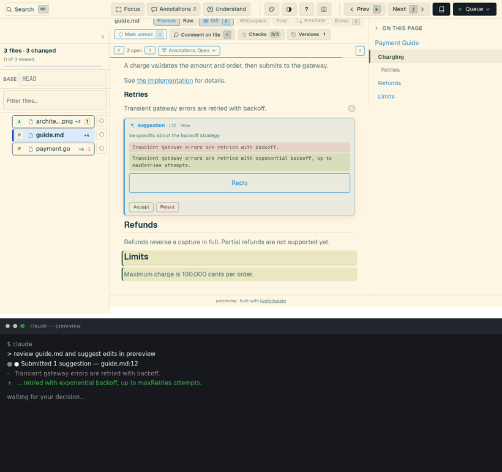</p>

**Pick between alternatives.** A row of one-tap comments sits under every comment
box. When the choice is yours to make, the agent offers two versions and you pick one.

<p align="center">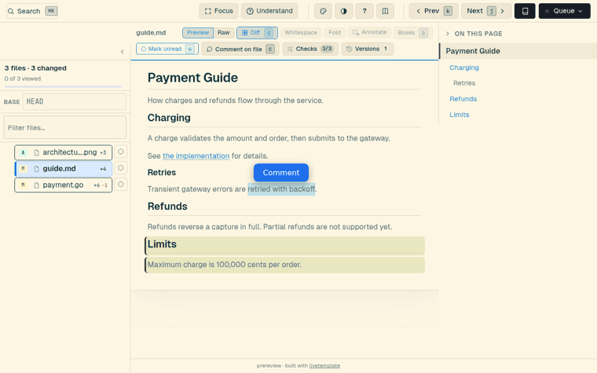</p>

**Roll back any agent edit.** Each batch the agent finishes is saved as a version
of the file with the agent's changelog. View it, diff it or restore it.

<p align="center">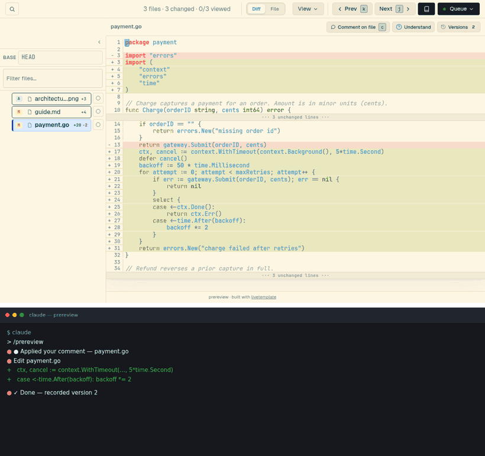</p>

**Checks and judges.** Built-in prose checks flag lines as you read, and you can
write your own. A judge is a yes/no rubric your agent answers for the whole file.

<p align="center">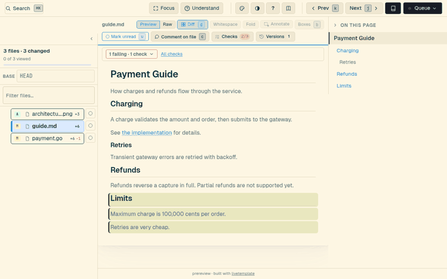</p>

**Quiz yourself on the diff.** Quiz me asks the agent for questions about the change.
Each question sits on the lines it asks about, and prereview checks those lines exist.

<p align="center">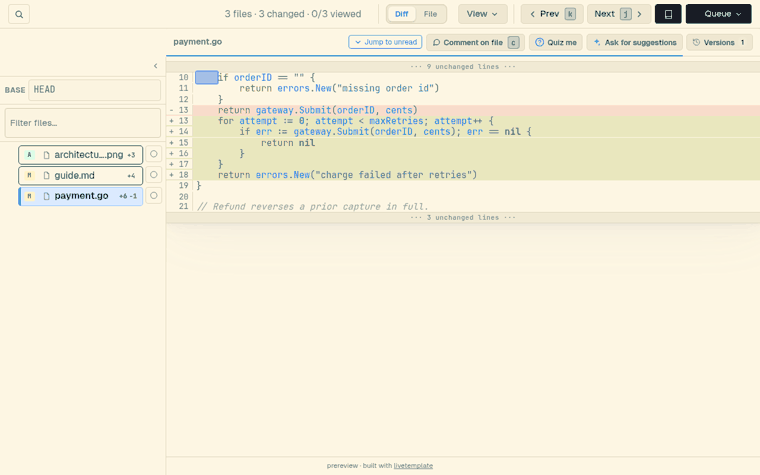</p>

**Search, themes and your phone.** <kbd>⌘K</kbd> searches file names and contents.
Three colour schemes come in light and dark. On a remote box prereview binds your
Tailscale address, so the same review works from your phone.

<p align="center">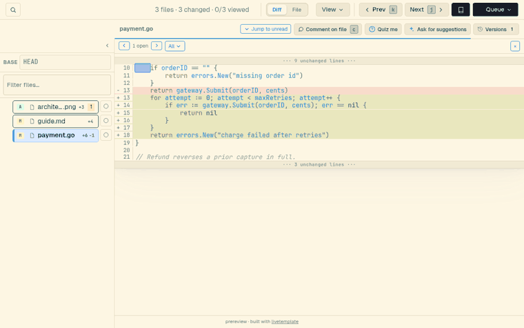</p>

<p align="center"></p>

<p align="center">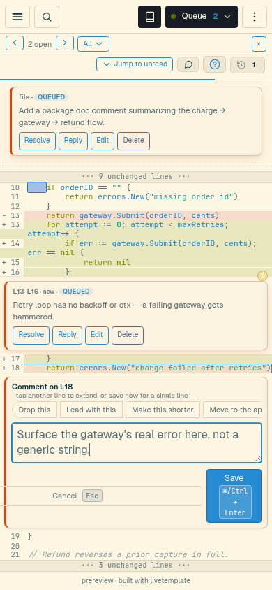</p>

The full tour, with every control and shortcut, is [docs/usage.md](docs/usage.md),
which is also built into the app (**⋯** menu, **Usage guide**).

## The learning loop

Each review teaches your agents what you want, so you don't have to repeat a
comment in the next review.

1. **You review.** Your comments, replies and accept/reject decisions are the
   evidence.
2. **A helper agent draws lessons from them.** When your agent goes idle with five
   or more new comments, replies or decisions, prereview passes them to a
   background learner, a helper agent started with the review. It proposes
   lessons, and each one quotes the comments it rests on. prereview never calls a
   model itself. The first time you run it, the learner can also read your past
   reviews.
3. **Lessons become skills and checks.** Accepted lessons (accepted automatically
   unless you turn that off) are written into skills such as `learned-writing`,
   installed for each agent on the machine. A lesson that can be checked also
   brings a checker or a judge.
4. **Your agents are told to use them.** prereview adds a short block naming the
   skills to each agent's memory file, such as `~/.claude/CLAUDE.md`. In Claude
   Code, a hook runs your checks after every edit.
5. **The agent writes the next change with them.** It loads your lessons and
   checks its own prose before you see it.

<p align="center">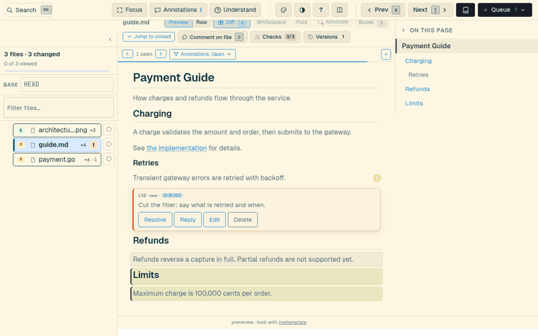</p>

Every lesson is in the Library, where you can edit, undo or export it, and you can
turn the loop off there. The details are in [docs/usage.md](docs/usage.md#learnings).

## Works with any LLM CLI

Comments are written to `.prereview/comments.csv` and streamed as JSON events. Any
agent that can read the queue (`prereview watch`, or `prereview comments --json`)
and edit files can work through your review.

| Agent | Install | Then |
|---|---|---|
| **Claude Code** | `prereview --install-skill --client=claude` | `/prereview` (live `watch` loop, multi-round) |
| **OpenAI Codex CLI** | `prereview --install-skill --client=codex` | `$prereview` / `/skills` |
| **Gemini CLI** | `prereview --install-skill --client=gemini` | `/prereview` |
| **opencode** | `prereview --install-skill --client=opencode` | `/prereview` or `opencode run --command prereview` |
| **aider** | `prereview --install-skill --client=aider` | `~/.config/prereview/aider/prereview-aider.sh <files>` |
| **cursor-agent** | `prereview --install-skill --client=cursor` | `cursor-agent -p --force "use prereview"` |

Only Claude Code runs the live `watch` loop. The other agents read
`prereview comments --json` once per turn. Per-agent details, what has been tested,
and how to wire up your own agent are in [docs/integrations.md](docs/integrations.md).

## How it's different

Most AI review tools have the model find the problems for you to read. prereview
works the other way: you spot what's wrong, in any artifact, and your agent makes
the fix before you push.

- **AI reviewers** (CodeRabbit, Qodo, pre-commit model hooks) write the review.
  prereview records yours as comments an agent acts on.
- **Team review tools** (Gerrit, Review Board) are multi-person, server-side and
  code-only. prereview is single-user, local, and reviews any artifact.
- **Diff viewers** (lazygit, tig, delta, difftastic) show changes. prereview adds
  anchored comments and hands them to an agent.

Other tools in the same space, worth a look:

- **[crit.md](https://crit.md/)**: review an agent's plans, diffs and running apps
  in the browser, with inline comments and round-by-round diffs. Local, any agent.
- **[diffx](https://github.com/wong2/diffx)**: a local code review tool for the
  coding-agent workflow.
- **[tuicr](https://tuicr.dev/)**: a terminal UI for reviewing a diff. It pushes a
  review to GitHub and other hosts, or copies Markdown for your agent.
- **[parley](https://cloudflavor.io/parley/)**: terminal-first review of local git
  diffs, with threads and AI sessions.

## Docs

- [docs/usage.md](docs/usage.md): everything the UI does.
- [docs/cli.md](docs/cli.md): every flag, subcommand and environment variable, and
  the files a review writes.
- [docs/install.md](docs/install.md): installing, upgrading and uninstalling.
- [docs/integrations.md](docs/integrations.md): each agent's integration.
- [docs/agent-setup.md](docs/agent-setup.md): setup steps for an agent to follow.
- [docs/security.md](docs/security.md): who can reach a review, and what prereview
  reads, writes, connects to and runs.
- [skill/SKILL.md](skill/SKILL.md) and [skill/reference.md](skill/reference.md): the
  protocol the agent follows.

## Development

prereview is built on [livetemplate](https://github.com/livetemplate/livetemplate):
the whole UI is server-rendered Go with no custom JavaScript, and when it needs a
primitive the framework lacks, the primitive goes into livetemplate.

```bash
git clone https://github.com/livetemplate/prereview
cd prereview
make sync-client   # copy the livetemplate client into internal/assets/client/
go build .
./prereview
```

Browser tests use chromedp and headless Chromium: `go test -tags=browser ./e2e/`.
`make screenshots` and `make gifs` regenerate the images in this README.

## License

MIT.
